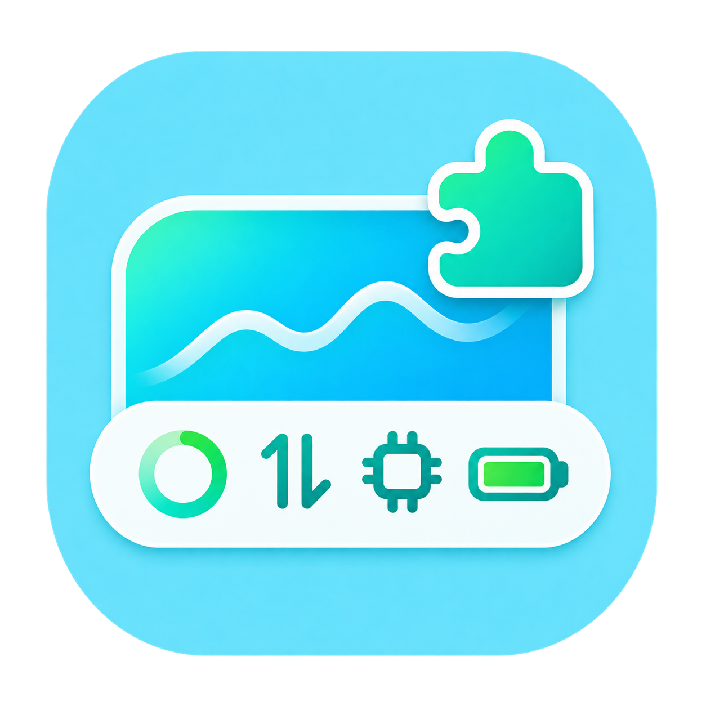

# DeskMonitor



可扩展的 Windows 任务栏与桌面监测工具，基于 TaskMonitor。基础宿主显示 CPU、内存、磁盘、GPU 和网络。插件可以独立安装，通过统一接口在任务栏、悬浮窗和详情页显示数据。

## 开始使用

1. 从 [GitHub Releases](https://github.com/noxowin/deskmonitor/releases/latest) 下载 `DeskMonitor.exe`，放到独立目录并运行。适用于 Windows 10 和 Windows 11，需要 .NET Framework 4.8。
2. 右键任务栏上的监测区域，打开 **设置 → 插件**。
3. 选择 **打开插件目录**，将下载的 `.plugin` 文件放进去，DeskMonitor 会自动加载。也可用 **导入插件** 选择同一个文件。已安装的旧版 ZIP 插件可以继续使用。
4. 点击任务栏中的插件读数，打开该插件的独立详情页。**设置 → 外观 → 项目顺序** 可以分别拖动每个插件。单个插件超过四个读数时用 `+N` 汇总，暂无数据的插件自动收起。

| 插件 | 显示内容 |
| --- | --- |
| 外设电量 | 鼠标、键盘、耳机和手柄的图标与电量 |
| 电脑电源 | 电脑电池电量、充电状态及 Windows 提供的剩余续航 |
| 今日进度 | 本地一天已经过去的比例和距离午夜的时间 |

安装 `peripheral-battery.plugin` 即可读取 Windows 上报的蓝牙电量和 Wireless Battery 支持的 2.4 GHz 接收器电量。插件内置 Wireless Battery 和 HeadsetControl，安装后自动采集。[上游版本和随包源码](extensions/peripheral-battery/vendor/README.md)

在外设电量详情页可逐个勾选要在任务栏显示的设备。所有设备隐藏或暂无可用电量时，任务栏不会为插件留空。从 **设置 → 插件 → 外设电量** 的下方可重新勾选设备。

使用 Kysona 协议的 2.4 GHz 鼠标（如 MpandaMouse 4K）偶尔读不到电量时，如果 USB 接收器仍在，插件会保留最近一次电量最多 30 分钟，并在详情标注「上次读数」及时间。接收器拔出后，下一次采集会清除该读数。

在 **设置 → 外观 → 强调色** 的色板中，点击「系统」色块跟随 Windows，也可选择预设色。色板会显示 Windows 当前的强调色。拖动设置左侧导航的右边缘可以调整宽度。

## 开发与编译

在 Windows 上安装 .NET SDK。宿主和示例目标框架为 .NET Framework 4.8。

```powershell
dotnet build DeskMonitor.sln -c Release
```

宿主输出为 `bin/Release/net48/DeskMonitor.exe`。各插件项目会在自己的 `bin/Release/net48/` 自动生成同名 `.plugin` 文件，上传和安装时只需分发这一个文件。也可用 `dotnet build extensions/<插件目录>/plugin.csproj -c Release` 单独构建插件。

插件以普通用户进程运行，通过标准输出返回 JSON。协议与安装包格式见 [插件 API](docs/plugin-api.md)。

## 来源与许可

任务栏、悬浮窗和系统指标基于 LineSoft 的 TaskMonitor。DeskMonitor 增加了独立插件宿主、插件管理、外观设置以及三个可独立安装的插件。原项目的 Apache-2.0 许可和版权声明已保留。[上游项目](https://github.com/linesoft2/TaskMonitor) · [许可证](LICENSE) · [第三方组件声明](THIRD-PARTY-NOTICES.md)
